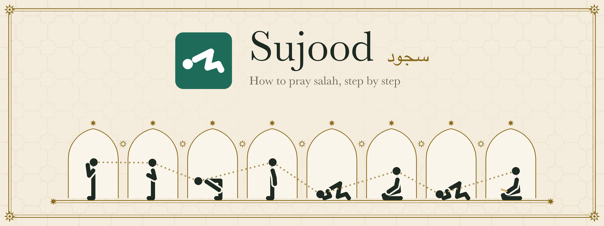
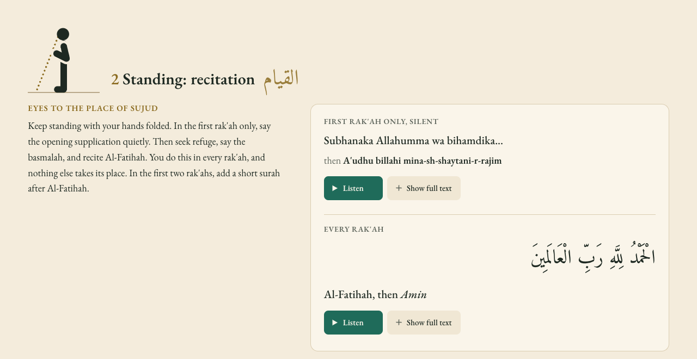

<picture>
  <source media="(prefers-color-scheme: dark)" srcset="img/banner-dark.png">
  
</picture>

[](https://github.com/stafawashere/sujood.online/actions/workflows/ci.yml)
[](https://github.com/stafawashere/sujood.online/actions/workflows/deploy.yml)

I made Sujood for anyone learning to pray, so the positions of salah and what to say in each one are all on one page.

### [sujood.online](https://sujood.online)

<picture>
  <source media="(prefers-color-scheme: dark)" srcset="img/screenshot-dark.png">
  
</picture>

## What's on the page

The eight positions of one rak'ah go down the page in order. Each one has a figure of the body, a short note on what to do, and what you say there in Arabic with a transliteration and the meaning. The longer recitations, like Al-Fatihah and the tashahhud, start collapsed and open with "Show full text". Most of them have a Listen button, so you can hear the line instead of guessing at it from the spelling.

A bar along the top of the screen shows where you are and lets you jump to any position. At the bottom there's a table of how many rak'ahs each of the five daily prayers has and which ones are recited aloud. Once you've visited the page, it opens without a connection.

## Languages

The page is in English, Arabic, Urdu, Bengali, Indonesian, Turkish and French, at `/`, `/ar/`, `/ur/`, `/bn/`, `/id/`, `/tr/` and `/fr/`. Arabic and Urdu pages run right to left.

The English is the original. The other six are machine translations, and no native speaker has checked any of them yet. Some of the religious wording is the kind of thing a teacher or imam in that language would phrase differently, so I'd like each one read by someone who knows the language and the prayer well. If that's you, see [CONTRIBUTING.md](CONTRIBUTING.md).

## Audio

None of the audio is in this repo. A Listen button streams the MP3 straight from where it's hosted, and the service worker doesn't cache it.

- Al-Fatihah and Al-Ikhlas are Mishary Rashid Alafasy's recitation, from [quranicaudio.com](https://quranicaudio.com).
- Everything else (the opening supplication, what you say in ruku, rising from it, sujud and the sitting, the tashahhud, the salawat and the du'a before the salam) is from [Hisn al-Muslim](https://www.hisnmuslim.com).

quranicaudio.com says its files are free for personal, non-commercial use. I couldn't find any terms on hisnmuslim.com. Sujood is free and has no ads, but if you run either site and would rather it didn't link to your files, please open an issue and I'll change it.

## Running it locally

You need Node 20 or newer. There's nothing to install.

```bash
npm run serve
```

That builds the site into `_site/` and serves it at http://localhost:8000. Any static server pointed at `_site/` works too. The fonts and the audio load from other sites, so you need to be online for those.

## How it's built

The words for each language live in `src/locales/`, one JSON file per language, with `en.json` as the reference. The Arabic of every recitation is in `src/arabic.json` and every page shares it, so a fix to the Arabic happens once and a translator can't change it by accident. `src/audio.json` maps each Listen button to its MP3, and `src/site.json` holds the order of the positions and the rak'ah counts.

`src/template.html` is the page with placeholders. `scripts/build.js` fills it in once per language and writes the result to `_site/`, along with the files in `static/`, the images in `img/` and a sitemap. It uses only Node's standard library. If a translation is missing a key that `en.json` has, the build stops and names the key.

The build also writes the service worker. Its list of files to cache comes from the pages it just built, so it can't fall behind when a file is added or renamed, and its cache name changes whenever one of those files does. Pages load from the network first and fall back to the cached copy when you're offline.

There's no framework because the page doesn't need one. All the text is in the HTML when it arrives, so it reads fine before any script runs. `static/app.js` is about 300 lines. It runs the Listen buttons, the collapsed text, the position bar and the Share button, and registers the service worker. The figures are inline SVG drawn on the same 100 by 100 grid, so the body is the same size in every position. The collapsed text uses `hidden="until-found"`, so searching the page in Chrome or Edge opens the section with the match.

`tools/make_images.py` draws the icons, `og.png` and the README banners from the same figure coordinates. It needs Pillow and runs on macOS because it uses the system Baskerville. `python3 tools/make_images.py img` redraws them.

## Tests

```bash
npm test
```

The tests use Node's built-in runner. They build the site into a temporary folder and check that every language gets a page with the right `lang` and `dir`, that every translation has every key in `en.json`, that no placeholder is left unfilled, that every internal link, asset path and `#` link points at something real, and that the service worker caches exactly the pages and assets in the build.

`npm run check-audio` checks that every audio URL still answers with an MP3. It isn't part of the tests because it depends on two other sites being up.

## Deploying

Every push to `main` runs `.github/workflows/deploy.yml`, which builds the site, runs the tests and publishes `_site/` to GitHub Pages. `static/CNAME` points sujood.online at it. Pull requests run the same build and tests in `.github/workflows/ci.yml` without deploying.

## Contributing

The two things that would help most are a native speaker checking a translation and anyone pointing out a mistake in a recitation, transliteration or meaning. [CONTRIBUTING.md](CONTRIBUTING.md) explains both.

## License

The code is under the [MIT License](LICENSE). The written content, the translations and the figures are under [CC BY 4.0](LICENSE-content). Neither covers the Arabic text of the Qur'an and the supplications, or the audio, which isn't in this repo.
